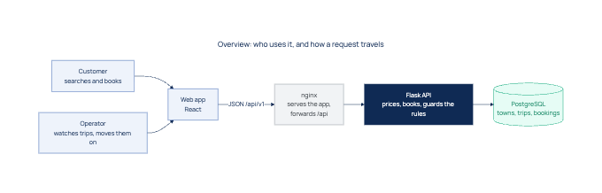
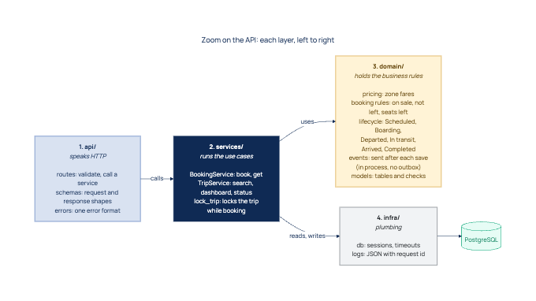

# XpressLines: fare and booking service

Customers search trips between 6 Nigerian towns, see the zone fare and seats left, and book seats to get a reference. Operators see every trip on a dashboard and move it through its lifecycle. A bus is never oversold, even under concurrent bookings.

**Docs:** [design](docs/DESIGN.md) · [handover](docs/HANDOVER.md) · [AI use](docs/AI_USE.md)

## How it works



1. **Search:** the customer picks two towns and a date; the API returns the zone fare and the trips with seats left.
2. **Book:** the API locks that trip's row, checks the rules (on sale, not departed, seats left), saves the booking and returns a reference. A second customer racing for the same last seat waits until the first booking is saved (a few milliseconds), then gets "sold out".
3. **Operate:** the dashboard lists all trips; the operator moves each one through Scheduled, Boarding, Departed, In transit, Arrived, Completed.

Inside the API, each layer has one job:



## Run it

```bash
docker compose up --build   # add -d to run it in the background
docker compose down         # stop it; add -v to also delete the data
```

| Open | Address |
|---|---|
| Book a trip | http://localhost:8080 |
| Admin dashboard | http://localhost:8080/admin |
| API docs | http://localhost:8080/api/v1/docs/swagger |

Development: `make db setup migrate seed`, then `make api` and `make web`. Tests: `make test`. Checks: `make lint`.

**Demo data** is loaded by `flask --app app seed` (`backend/app/cli/seed.py`) on first start. Reset it with `make reseed` or `docker compose exec api flask --app app seed --reset`; trip times are relative to now, so reseed before a demo.

## Example

```bash
API=http://localhost:8080/api/v1
curl "$API/fares?origin=LOS&destination=KAN"            # 35.00 USD
curl -X POST "$API/bookings" -H 'Content-Type: application/json' \
     -d '{"trip_id": 3, "passenger_name": "Ada Obi", "seats": 1}'
# 201 {"reference": "H7Y38W5N", ...}, then for the next customer:
# 409 {"error": {"code": "not_enough_seats", "message": "This trip is sold out"}}
```

`make race`: 20 customers try to book the last seat at once; exactly one gets it.

## Entry points

| To see... | Backend (`backend/app/`) | Frontend (`frontend/src/`) |
|---|---|---|
| How the app starts | `__init__.py` (`create_app`) | `main.tsx` |
| Where a request or page arrives | `api/routes.py` | `pages/` |
| How a booking is made, with the lock | `services/booking.py` | `hooks/useBookingFlow.ts` |
| The business rules | `domain/` (fares, booking rules, trip lifecycle) | `lib/` (form checks, formatting) |

